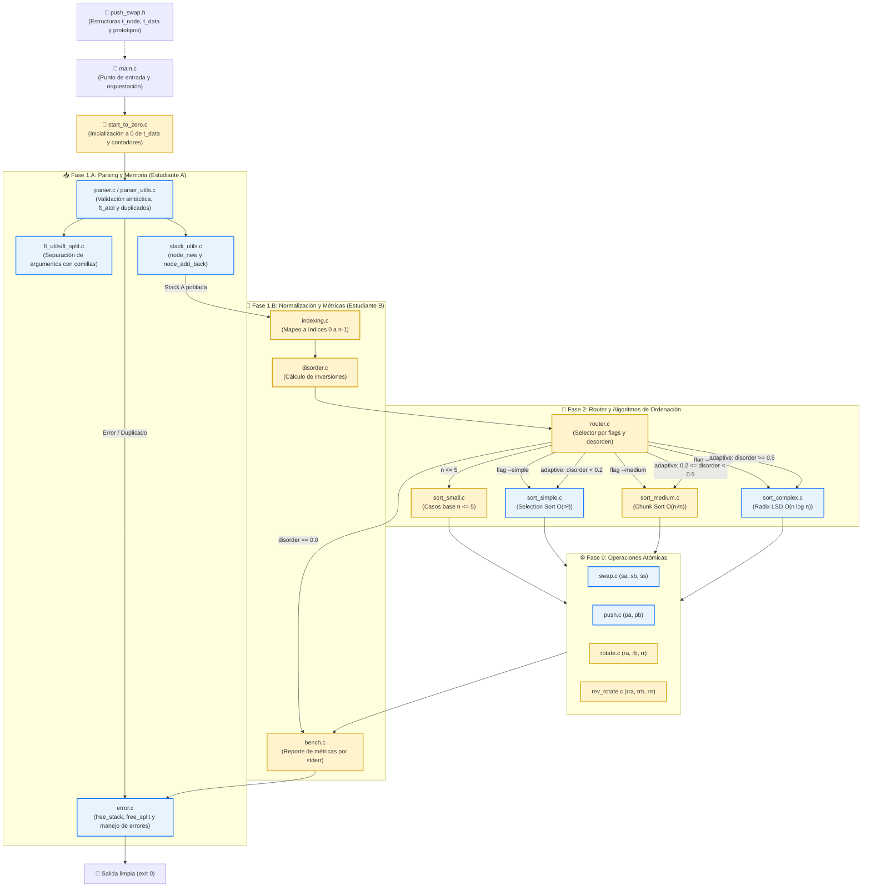

*Este proyecto ha sido creado como parte del currículo de 42 por alegome2 (Estudiante A) y joquinta (Estudiante B).*

# Push_swap

## Índice

- [Push\_swap](#push_swap)
  - [Índice](#índice)
  - [Descripción](#descripción)
    - [Objetivos y Características Principales:](#objetivos-y-características-principales)
  - [Instrucciones de Compilación y Uso](#instrucciones-de-compilación-y-uso)
    - [Requisitos Previos](#requisitos-previos)
    - [Compilación](#compilación)
    - [Ejecución](#ejecución)
  - [Arquitectura del Proyecto y Estructura de Archivos](#arquitectura-del-proyecto-y-estructura-de-archivos)
    - [Estructuras Principales (`push_swap.h`)](#estructuras-principales-push_swaph)
  - [Concepto Clave 1: Modelo de Pilas y Operaciones Atómicas](#concepto-clave-1-modelo-de-pilas-y-operaciones-atómicas)
  - [Concepto Clave 2: Métrica de Desorden (*Disorder Index*) y Adaptatividad](#concepto-clave-2-métrica-de-desorden-disorder-index-y-adaptatividad)
    - [Justificación de los Umbrales Adoptados en `router.c`:](#justificación-de-los-umbrales-adoptados-en-routerc)
  - [Diagrama de Flujo](#diagrama-de-flujo)
  - [Fase 1: Parseo, Inicialización y Normalización](#fase-1-parseo-inicialización-y-normalización)
  - [Fase 2: Algoritmos y Estrategias Implementadas](#fase-2-algoritmos-y-estrategias-implementadas)
    - [1. Casos Base (`sort_small.c`) — $n \\le 5$](#1-casos-base-sort_smallc--n-le-5)
    - [2. Selection Sort (`sort_simple.c`) — $\\mathcal{O}(n^2)$](#2-selection-sort-sort_simplec--mathcalon2)
    - [3. Chunk Sort / Ventana Deslizante (`sort_medium.c`) — $\\mathcal{O}(n\\sqrt{n})$](#3-chunk-sort--ventana-deslizante-sort_mediumc--mathcalonsqrtn)
    - [4. Radix Sort LSD (`sort_complex.c`) — $\\mathcal{O}(n \\log n)$](#4-radix-sort-lsd-sort_complexc--mathcalon-log-n)
  - [Estrategias y Complejidad Teórica](#estrategias-y-complejidad-teórica)
  - [Casos Límite (Edge Cases) y Pruebas](#casos-límite-edge-cases-y-pruebas)
  - [Depuración, Leaks y Benchmarking](#depuración-leaks-y-benchmarking)
    - [Detección de Fugas de Memoria con Valgrind](#detección-de-fugas-de-memoria-con-valgrind)
    - [Compilación con AddressSanitizer (ASan)](#compilación-con-addresssanitizer-asan)
    - [Verificación de Corrección y Rendimiento](#verificación-de-corrección-y-rendimiento)
  - [Notas Técnicas y Decisiones de Diseño](#notas-técnicas-y-decisiones-de-diseño)
  - [Recursos y Uso de IA](#recursos-y-uso-de-ia)
    - [Referencias](#referencias)
    - [Uso de Inteligencia Artificial](#uso-de-inteligencia-artificial)
    - [Aprendizaje Peer-to-Peer](#aprendizaje-peer-to-peer)

---

## Descripción

El proyecto **Push_swap** consiste en ordenar un conjunto de números enteros únicos recibidos inicialmente en una pila (`Stack A`) utilizando una pila auxiliar (`Stack B`) y un repertorio restringido de operaciones atómicas de manipulación de punteros, buscando realizar la **menor cantidad de operaciones posible**.

Al iniciar el programa:
- **`stack_a`** contiene una cantidad arbitraria de números enteros (positivos y/o negativos) sin duplicados.
- **`stack_b`** comienza completamente vacía.
- **Meta:** Dejar todos los números ordenados de menor a mayor en la cima de `stack_a` imprimiendo por salida estándar (`stdout`) la secuencia exacta de movimientos ejecutados.

### Objetivos y Características Principales:
- **Estrategia Adaptativa por Defecto:** Mide el índice de desorden normalizado ($[0.0, 1.0]$) antes de ejecutar cualquier movimiento y canaliza la ejecución hacia la familia algorítmica de complejidad óptima ($\mathcal{O}(n^2)$, $\mathcal{O}(n\sqrt{n})$ o $\mathcal{O}(n\log n)$).
- **Selector Explícito de Estrategias:** Admite flags opcionales (`--simple`, `--medium`, `--complex`, `--adaptive`) para auditar formalmente las distintas cotas de complejidad.
- **Telemetría y Benchmarking (`--bench`):** Reporta a través del descriptor de errores estándar (`fd 2`) el desglose exacto de operaciones utilizadas sin contaminar `stdout`.
- **Cero Fugas de Memoria y Norminette:** Gestión estricta de listas doblemente enlazadas para evitar *memory leaks* o *segfaults*, cumpliendo todas las normas de estilo de 42.

---

## Instrucciones de Compilación y Uso

### Requisitos Previos
Entorno Unix/Linux o macOS con compilador `cc` / `gcc` / `clang` y utilidad `make`.

### Compilación
El proyecto incluye un `Makefile` con las reglas estándar de 42:
```bash
make        # Compila el ejecutable push_swap
make clean  # Elimina los archivos objeto (.o)
make fclean # Elimina los archivos objeto y el ejecutable
make re     # Recompila el proyecto desde cero
```

### Ejecución
El programa admite argumentos individuales, cadenas entrecomilladas (o una mezcla de ambos), así como flags de selección de estrategia y telemetría:
```bash
# Ejecución adaptativa por defecto
./push_swap 4 67 3 87 23

# Argumentos entre comillas o combinados
./push_swap "4 67 3 87 23"
./push_swap "4 67" 3 "87 23"

# Ejecución forzando una estrategia específica
./push_swap --simple 4 67 3 87 23
./push_swap --medium 4 67 3 87 23
./push_swap --complex 4 67 3 87 23

# Ejecución mostrando métricas por stderr
./push_swap --bench 4 67 3 87 23
```
*(Nota: Si se pasa un argumento no numérico, fuera del rango de un `int` (`INT_MIN` a `INT_MAX`) o con números duplicados, el programa libera la memoria y muestra `Error\n` por `stderr`).*

---

## Arquitectura del Proyecto y Estructura de Archivos

La estructura del repositorio divide el código de forma modular entre utilidades auxiliares, parseo, inicialización, operaciones atómicas, métricas y estrategias de ordenación:

```text
push_swap/
├── ft_utils/               # Funciones auxiliares estilo Libft
│   ├── ft_itoa.c
│   ├── ft_putnbr_fd.c
│   ├── ft_putstr_fd.c
│   ├── ft_split.c
│   ├── ft_strdup.c
│   ├── ft_strlen.c
│   └── ft_substr.c
├── push_swap.h             # Estructuras (t_node, t_data), enums y prototipos
├── Makefile                # Reglas de compilación (all, clean, fclean, re) y dependencias
├── main.c                  # Punto de entrada, inicialización y flujo principal
├── start_to_zero.c         # Inicialización a cero de contadores y campos de t_data
├── parser.c                # Parseo y validación de argumentos de entrada
├── parser_utils.c          # Conversión ft_atol y comprobación de duplicados
├── error.c                 # Gestión de errores y liberación segura de memoria
├── stack_utils.c           # Creación e inserción de nodos en lista doblemente enlazada
├── indexing.c              # Normalización de valores a índices [0 .. n-1]
├── disorder.c              # Cálculo del índice de desorden (inversiones)
├── bench.c                 # Conteo y reporte de métricas por stderr (--bench)
├── router.c                # Selector de algoritmos por flags y umbral de desorden
├── push.c                  # Operaciones pa, pb
├── swap.c                  # Operaciones sa, sb, ss
├── rotate.c                # Operaciones ra, rb, rr
├── rev_rotate.c            # Operaciones rra, rrb, rrr
├── sort_small.c            # Ordenación óptima para casos base (n <= 5)
├── sort_simple.c           # Selection Sort O(n²)
├── sort_medium.c           # Chunk Sort / Ventana deslizante O(n√n)
└── sort_complex.c          # Radix Sort LSD O(n log n)
```

### Estructuras Principales (`push_swap.h`)

```c
typedef struct s_node
{
	struct s_node	*next;
	struct s_node	*prev;
	int				value;
	int				index;
}	t_node;

typedef enum strategy
{
	ADAPTIVE = 0,
	SIMPLE,
	MEDIUM,
	COMPLEX
}	t_strategy;

typedef struct s_data
{
	t_node		*stack_a;
	t_node		*stack_b;
	int			size_a;
	int			size_b;
	int			total_count;
	int			ra_count;
	int			rb_count;
	int			rr_count;
	int			rra_count;
	int			rrb_count;
	int			rrr_count;
	int			pa_count;
	int			pb_count;
	int			sa_count;
	int			sb_count;
	int			ss_count;
	t_strategy	strategy;
	double		disorder;
}	t_data;
```
- **`t_node`:** Nodo de lista doblemente enlazada. `value` almacena el entero real y `index` su posición relativa ordenada ($0$ a $n - 1$).
- **`t_data`:** Controlador central inicializado mediante `start_to_zero` y recibido por todos los algoritmos y operaciones atómicas, actualizando automáticamente las cimas, los tamaños (`size_a`, `size_b`) y los contadores de telemetría.

---

## Concepto Clave 1: Modelo de Pilas y Operaciones Atómicas

A diferencia de un array contiguo indexado donde cualquier posición es accesible en tiempo constante $\mathcal{O}(1)$, el modelo de ejecución de **Push_swap** restringe el acceso estrictamente a los extremos de dos pilas (`A` y `B`).

Las operaciones atómicas permitidas se subdividen en cuatro módulos:

1. **Swap (`swap.c` — `sa`, `sb`, `ss`):** Intercambia las posiciones de los dos primeros nodos en la cima de la pila seleccionada.
2. **Push (`push.c` — `pa`, `pb`):** Desvincula el nodo superior de una pila y lo inserta en la cima de la otra.
3. **Rotate (`rotate.c` — `ra`, `rb`, `rr`):** Desplaza todos los nodos hacia arriba una posición; el nodo de la cima pasa a ser el último.
4. **Reverse Rotate (`rev_rotate.c` — `rra`, `rrb`, `rrr`):** Desplaza todos los nodos hacia abajo una posición; el último nodo pasa a ser el primero.

```text
       Stack A                 Stack B
    ┌───────────┐           ┌───────────┐
    │   top     │  ──pb──►  │   top     │
    │   node    │  ◄─pa───  │   node    │
    │   ...     │           │   ...     │
    │   bottom  │           │   bottom  │
    └───────────┘           └───────────┘
```

Cada operación realiza una reasignación precisa de los punteros `next` y `prev` para mantener la integridad de la lista doblemente enlazada sin perder referencias ni generar ciclos.

---

## Concepto Clave 2: Métrica de Desorden (*Disorder Index*) y Adaptatividad

El **Índice de Desorden** (`disorder.c`) es una métrica matemática continua en el intervalo $[0.0, 1.0]$ que cuantifica el grado de desalineación de la pila respecto al orden ascendente perfecto.

Se define formalmente evaluando todas las parejas $(i, j)$ tales que $i < j$:
$$\text{Desorden} = \frac{\text{Número de inversiones}}{\text{Total de parejas evaluadas}} = \frac{\sum_{i < j} [A[i] > A[j]]}{\frac{n(n - 1)}{2}}$$

### Justificación de los Umbrales Adoptados en `router.c`:
- **$\text{Desorden} = 0.0$:** La secuencia ya está estrictamente ordenada. El programa retorna inmediatamente con $0$ operaciones.
- **$n \le 5$ (`sort_small.c`):** Para pilas de hasta 5 elementos, se aplica ordenación directa optimizada con el mínimo número posible de movimientos.
- **$\text{Desorden} < 0.2$ (Régimen Cuadrático Simple $\mathcal{O}(n^2)$ — `sort_simple.c`):** La pila presenta un orden casi total (pocas inversiones). En estos casos, un algoritmo de selección directa resulta ligero y requiere muy pocas extracciones.
- **$0.2 \le \text{Desorden} < 0.5$ (Régimen Intermedio $\mathcal{O}(n\sqrt{n})$ — `sort_medium.c`):** Desorden moderado. Se utiliza una partición en ventanas dinámicas (*Chunk Sort*) que envía elementos a `stack_b` formando un reloj de arena y los recupera de mayor a menor.
- **$\text{Desorden} \ge 0.5$ (Régimen Complejo $\mathcal{O}(n\log n)$ — `sort_complex.c`):** Desorden severo o permutaciones inversas. Se recurre a una ordenación sistemática bit a bit (*Radix LSD*).

---

## Diagrama de Flujo



---

## Fase 1: Parseo, Inicialización y Normalización

Antes de ejecutar cualquier algoritmo, el programa prepara la estructura de control y transforma los argumentos (`char **argv`) en una lista doblemente enlazada segura y normalizada:

1. **Inicialización de estado (`start_to_zero.c`):** Pone a `0` y `NULL` todos los punteros de pila, tamaños (`size_a`, `size_b`), el índice de desorden y todos los contadores de operaciones (`total_count`, `ra_count`, `pb_count`, etc.) dentro de `t_data` antes de comenzar la ejecución.
2. **Fragmentación de cadenas (`parser.c` + `ft_utils/ft_split.c`):** Recorre `argv` y divide cada cadena por espacios mediante `ft_split`, permitiendo entradas individuales o entrecomilladas. Si un argumento está vacío (`""` o `"   "`), aborta limpiamente.
3. **Validación sintáctica (`parser.c`):** Verifica que cada *token* contenga únicamente un signo opcional inicial (`'+'` o `'-'`) seguido de al menos un dígito decimal (`'0'`–`'9'`).
4. **Control de desbordamiento (`parser_utils.c` — `ft_atol`):** Convierte la cadena a `long` para detectar valores fuera del rango de 32 bits (`INT_MIN` $-2147483648$ a `INT_MAX` $2147483647$) antes de convertir a `int`.
5. **Detección de duplicados (`parser_utils.c`):** Recorre los nodos ya insertados en `stack_a` comprobando que el nuevo número no exista previamente.
6. **Construcción de la lista (`stack_utils.c`):** Crea cada nodo con `node_new` y lo añade al final con `node_add_back`, manteniendo los enlaces `next` y `prev` en el orden exacto de entrada.
7. **Liberación ante errores (`error.c`):** Si falla cualquier validación, `handle_error` libera tanto los arrays de `ft_split` como todos los nodos creados hasta ese instante, escribe `"Error\n"` en `stderr` (`fd 2`) y sale con `exit(1)`.
8. **Indexación (`indexing.c`):** Asigna a cada nodo su posición final ordenada (`index` de `0` a `size_a - 1`), desacoplando los algoritmos de los valores negativos o dispersos.

---

## Fase 2: Algoritmos y Estrategias Implementadas

La selección del algoritmo se centraliza en `router.c`:

```c
static void	sort_adaptive(t_data *s_data)
{
	if (s_data->disorder < 0.2)
		sort_simple(s_data);
	else if (s_data->disorder < 0.5)
		sort_medium(s_data);
	else
		sort_complex(s_data);
	return ;
}

void	router(t_data *s_data)
{
	if (!s_data || s_data->disorder == 0.0)
		return ;
	else if (s_data->size_a <= 5)
		sort_small(s_data);
	else if (s_data->strategy == SIMPLE)
		sort_simple(s_data);
	else if (s_data->strategy == MEDIUM)
		sort_medium(s_data);
	else if (s_data->strategy == COMPLEX)
		sort_complex(s_data);
	else
		sort_adaptive(s_data);
	return ;
}
```

### 1. Casos Base (`sort_small.c`) — $n \le 5$
Para conjuntos muy reducidos ($n \le 5$), resuelve la ordenación mediante comparaciones directas (`sa`, `ra`, `rra`) para 2 y 3 elementos, o extrayendo los elementos mínimos hacia `stack_b` para 4 y 5 elementos antes de ordenar los 3 restantes.

### 2. Selection Sort (`sort_simple.c`) — $\mathcal{O}(n^2)$
Activado mediante `--simple` o en modo adaptativo cuando el desorden es bajo ($\text{disorder} < 0.2$):
1. **`find_min_pos`:** Localiza la posición del nodo con menor índice en `stack_a`.
2. **`move_to_top`:** Sube ese nodo a la cima usando `ra` (`pos <= size_a / 2`) o `rra` (`pos > size_a / 2`).
3. **`pb`:** Empuja el mínimo a `stack_b` y repite hasta vaciar `stack_a`, devolviendo finalmente todos los elementos con `pa`.

### 3. Chunk Sort / Ventana Deslizante (`sort_medium.c`) — $\mathcal{O}(n\sqrt{n})$
Activado mediante `--medium` o en modo adaptativo con desorden moderado ($0.2 \le \text{disorder} < 0.5$):
- **Fase 1 (`push_chunks_to_b`):** Define un tamaño de ventana (`range = 20` para $n \le 100$, `range = 40` para $n > 100$) y un contador base `i = 0`. Mientras queden nodos en `stack_a`:
  - Si `index <= i`: envía a `B` (`pb`), lo baja al fondo (`rb`) e incrementa `i++`.
  - Si `index <= i + range`: envía a `B` (`pb`) dejándolo arriba e incrementa `i++`.
  - En caso contrario: rota `A` (`ra`).
  Esto distribuye los elementos en `stack_b` con forma de **reloj de arena** (los índices altos quedan cerca de la cima o del fondo).
- **Fase 2 (`push_back_to_a` + `find_max_pos`):** Localiza sucesivamente el índice máximo en `stack_b` (`size_b - 1`), lo sube por el camino más corto (`rb` o `rrb`) y lo devuelve a `stack_a` con `pa`.

### 4. Radix Sort LSD (`sort_complex.c`) — $\mathcal{O}(n \log n)$
Activado mediante `--complex` o en modo adaptativo con desorden alto ($\text{disorder} \ge 0.5$):
- Clasifica los índices normalizados bit a bit desde el bit menos significativo (`i = 0`) hasta `get_max_bits(size_a - 1)`:
  - Evaluando `((data->stack_a->index >> i) & 1)`: si el bit es **`0`**, envía el nodo a `stack_b` (`pb`); si es **`1`**, lo rota al fondo de `stack_a` (`ra`).
  - Al finalizar cada pasada por los `size` elementos iniciales, vacía `stack_b` de vuelta a `stack_a` (`pa`).

---

## Estrategias y Complejidad Teórica

| 🧩 Algoritmo | Archivo | 🚩 Cuándo se activa | 📐 Nivel de desorden | ⏱️ Complejidad |
| :--- | :--- | :--- | :--- | :--- |
| **Casos Base** | `sort_small.c` | $n \le 5$ (prioritario si no está ordenada) | Indiferente ($\text{disorder} > 0$) | $\mathcal{O}(1)$ |
| **Selection Sort** | `sort_simple.c` | Flag `--simple` O `--adaptive` bajo | $\text{disorder} < 0.2$ | $\mathcal{O}(n^2)$ |
| **Chunk Sort** | `sort_medium.c` | Flag `--medium` O `--adaptive` moderado | $0.2 \le \text{disorder} < 0.5$ | $\mathcal{O}(n\sqrt{n})$ |
| **Radix Sort LSD** | `sort_complex.c` | Flag `--complex` O `--adaptive` alto | $\text{disorder} \ge 0.5$ | $\mathcal{O}(n \log n)$ |

---

## Casos Límite (Edge Cases) y Pruebas

- **Entradas inválidas:** Cadenas no numéricas (`"123a"`), signos aislados (`"+"`, `"-"`, `"--5"`) o espacios vacíos (`""`) retornan `Error\n` en `fd 2`.
- **Integer Overflow:** Números fuera de $[-2147483648, 2147483647]$ son rechazados gracias al parseo previo con `long` (`ft_atol`).
- **Duplicados:** Cualquier repetición aborta la ejecución liberando la memoria reservada hasta ese punto.
- **Sin parámetros / Lista ordenada:** Ejecutar `./push_swap` sin argumentos o con una lista ya ordenada (`disorder == 0.0`) finaliza sin imprimir operaciones.

---

## Depuración, Leaks y Benchmarking

### Detección de Fugas de Memoria con Valgrind
```bash
valgrind --leak-check=full --show-leak-kinds=all --track-origins=yes ./push_swap 5 2 8 1 9
```

### Compilación con AddressSanitizer (ASan)
```bash
make CFLAGS="-Wall -Wextra -Werror -g3 -fsanitize=address" re
./push_swap 4 2 7 1 3
```

### Verificación de Corrección y Rendimiento
```bash
# Comprobación con el checker oficial
ARG="4 67 3 87 23"; ./push_swap $ARG | ./checker_linux $ARG

# Prueba de rendimiento con 100 y 500 números aleatorios
ARG=$(shuf -i 1-100 -n 100 | tr '\n' ' '); ./push_swap $ARG | wc -l
ARG=$(shuf -i 1-500 -n 500 | tr '\n' ' '); ./push_swap $ARG | wc -l
```

---

## Notas Técnicas y Decisiones de Diseño

- **¿Por qué Radix Sort opera sobre `index` y no sobre `value`?** La manipulación de bits (`>>` y `& 1`) requiere enteros no negativos y acotados. Normalizar a índices $[0, n - 1]$ evita problemas con el bit de signo de números negativos en complemento a dos y garantiza que el número máximo de pasadas sea $\lceil \log_2(n) \rceil$ (7 bits para 100 números, 9 bits para 500).
- **Congelación de `size` en Radix Sort:** Dentro de cada pasada de `sort_complex.c`, `pb` reduce `data->size_a`. Guardar `size = data->size_a` antes del bucle interior garantiza que se evalúen todos los nodos de la pasada sin acortar el recorrido.
- **Gestión de memoria sin `free` intermedio:** Los nodos se reservan una única vez durante el parseo (`node_new`); los algoritmos únicamente reenlazan punteros `next` y `prev`. Toda la memoria se libera de forma centralizada en `error.c` / `main.c`.
- **Cumplimiento estricto de Norminette:** Máximo 25 líneas por función, máximo 5 funciones por archivo `.c`, uso exclusivo de bucles `while` y declaración de variables al inicio de cada bloque.

---

## Recursos y Uso de IA

### Referencias
- Knuth, Donald. *The Art of Computer Programming, Volume 3: Sorting and Searching*.
- Documentación sobre operadores bit a bit en C (`<<`, `>>`, `&`) y análisis de complejidad en pilas restringidas.
- Subject oficial del proyecto **Push_swap** (42 Network).

### Uso de Inteligencia Artificial
- **Tareas asistidas por IA:** Discusión de cotas teóricas de complejidad según los umbrales de desorden y estructuración/maquetación de la documentación técnica y diagramas del proyecto.
- **Trabajo desarrollado por los estudiantes:** Toda la arquitectura en C, algoritmos, control de punteros, gestión de memoria y baterías de pruebas fueron diseñados, implementados y validados por ambos integrantes del equipo.

### Aprendizaje Peer-to-Peer

* **Evaluaciones entre pares (*peer-evaluations*):** Puesta en común del código con otros estudiantes de la escuela para validar la solidez del flujo lógico, contrastar alternativas en la gestión de memoria dinámica y verificar el cumplimiento riguroso de la Norminette.